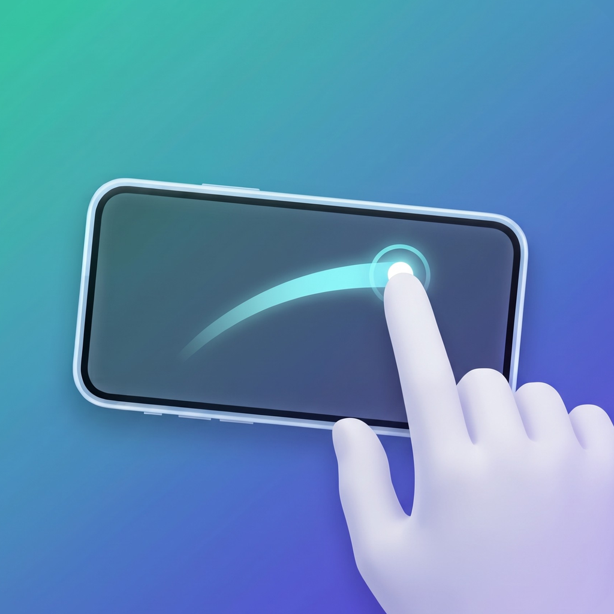
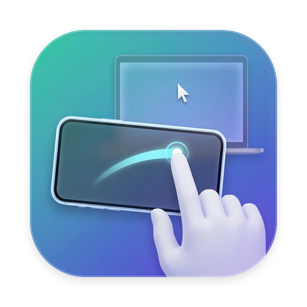

# 掌控板 Palmpad

把 iPhone 或安卓手机变成 Mac 的触控板。手机只负责采集触摸，Mac 端识别手势，再生成和自带触控板相同格式的系统事件，所以指针加速和滚动惯性的手感，以及调度中心、启动台的动画，都和自带触控板一致。

<p>
  
  
</p>

## 功能

- **触控板手势**：单指移动与轻点、双指滚动（带惯性）、双指缩放与旋转、智能缩放、右键、从右边缘轻扫打开通知中心、三指拖移、三指翻页、四指切换空间、调度中心、App Exposé、捏合打开启动台、张开显示桌面。
- **跟随系统设置**：手势开关、跟踪速度、自然滚动等直接读取 Mac「系统设置 › 触控板」。
- **手势快捷键**：一指按住，另一指在左侧轻点发送 ⌘W，在右侧轻点发送 ⌘Q。手机和 Mac 自带触控板上都能用，在菜单栏开关。
- **三种连接方式**：同一 Wi-Fi、Mac 连接手机热点、数据线（iPhone 经 usbmuxd，安卓经 adb）。
- **加密配对**：首次连接时在 Mac 上核对 6 位确认码，之后的通信全部加密。
- **手势诊断**：按手势分别在自带触控板或手机上录制，对比系统和掌控板各自识别的结果，用于校准。

## 系统要求

| 端 | 要求 |
|---|---|
| Mac | macOS 27 |
| iPhone | iOS 27 |
| 安卓 | Android 17（API 37） |
| 开发 | Xcode 27、[XcodeGen](https://github.com/yonaskolb/XcodeGen)、JDK 21、Android SDK |

## 构建与安装

### Mac 与 iPhone

把 `apple/project.yml` 里的 `DEVELOPMENT_TEAM` 改成自己的开发者团队编号，然后生成工程：

```bash
cd apple
xcodegen generate
```

编译 Mac 端，并把产物复制到「应用程序」文件夹：

```bash
xcodebuild -project MTM.xcodeproj -scheme MTM-Mac -configuration Debug -derivedDataPath build build
ditto build/Build/Products/Debug/Palmpad.app /Applications/Palmpad.app
```

编译 iPhone 端并安装。`<UDID>` 用 `xcrun devicectl list devices` 查到；指定具体设备，Xcode 才会登记设备并生成描述文件：

```bash
xcodebuild -project MTM.xcodeproj -scheme MTM-iOS -configuration Debug -derivedDataPath build-ios -destination 'id=<UDID>' -allowProvisioningUpdates -allowProvisioningDeviceRegistration build
xcrun devicectl device install app --device <UDID> build-ios/Build/Products/Debug-iphoneos/Palmpad.app
```

用免费开发者账号签名时，描述文件 7 天后过期，需要重新执行上面两条命令。

### 安卓

```bash
cd android
./gradlew assembleDebug
adb install -r app/build/outputs/apk/debug/app-debug.apk
```

## 使用

1. 打开 Mac 端，菜单栏出现手形图标。在「系统设置 › 隐私与安全性 › 辅助功能」里允许「掌控板」。
2. 手机打开掌控板，选择要连接的 Mac，在 Mac 弹出的窗口里核对确认码后点「允许」。
3. 之后手机打开即自动连接。菜单栏里可以查看连接状态、移除已配对设备、开关手势快捷键、打开手势诊断、设置登录时启动。

小米 HyperOS 的三指截屏等手势会抢走三指触摸。把掌控板加入「游戏加速」，并打开其中的「关闭三指截图」，掌控板在前台时系统就不再响应这些手势。

## 开发

运行测试：

```bash
(cd apple/MTMKit && swift test)
(cd android && ./gradlew test)
```

用当前的手势引擎重新分析一份诊断录制，`-timeline` 按时间列出系统和掌控板各自识别到的每个手势：

```bash
/Applications/Palmpad.app/Contents/MacOS/Palmpad -summarize ~/Library/Logs/MTM/diag-scroll-trackpad.jsonl -timeline
```

Mac 端日志和诊断录制都在 `~/Library/Logs/MTM`。

## 项目结构

```
apple/
  MTMKit/          Swift 包：Wire（通信协议与加密）、Engine（手势识别引擎）及测试
  Mac/             Mac 菜单栏应用：连接管理、事件注入、手势诊断
  iOS/             iPhone 应用：触控区与连接
  project.yml      XcodeGen 工程描述
android/           安卓应用（Kotlin），协议实现与 Swift 端一致
PROTOCOL.md        通信协议
HANDOFF.md         项目交接文档：架构、实现细节、校准依据、已知问题
LICENSE            MIT 许可证
vectors.json       Swift 与 Kotlin 两端协议互通的测试数据
```

## 许可证

[MIT](LICENSE)
